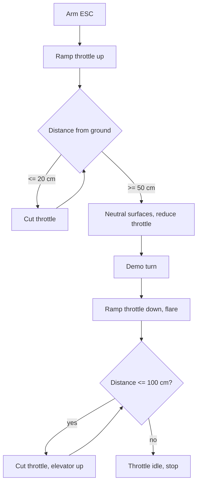

# RC Plane Autopilot

An Arduino-based experimental autopilot that runs an automated takeoff, short manoeuvre and landing sequence on an RC plane using an ultrasonic ground-distance sensor.


## Overview

This project is a system that lets an RC plane take off and land on its own. An Arduino drives the ESC (throttle), the aileron servo and the elevator servo through a pre-programmed flight sequence, and uses an HC-SR04-style ultrasonic sensor to measure the height above the ground during takeoff and landing. It is an early experimental prototype: the sequence is time-based and does not take input from an RC transmitter.

## Features

- ESC arming routine at startup (900 µs throttle signal for 4 seconds)
- Gradual throttle ramp-up for takeoff (1000 → 1500 µs in 10 µs steps)
- Ultrasonic altitude check after takeoff:
  - Cuts throttle if the plane is still within 20 cm of the ground (failed takeoff)
  - Continues the sequence once it is 50 cm or more above the ground
- Throttle reduction to a cruise/idle setting after takeoff
- Demonstration turn using aileron and elevator
- Gradual throttle ramp-down and elevator flare for landing
- Throttle cut when the plane is within 100 cm of the ground during landing
- Serial debug output (9600 baud) of throttle values and measured distance

## Hardware

| Component | Purpose |
|---|---|
| Arduino board (e.g. Uno / Nano) | Runs the flight sequence |
| ESC + brushless motor | Propulsion, controlled as a servo signal |
| Servo (aileron) | Roll control |
| Servo (elevator) | Pitch control |
| Ultrasonic distance sensor (HC-SR04 or similar) | Measures height above the ground |
| Flight battery / BEC | Powers the ESC, servos and Arduino |

## Pin Connections

| Arduino Pin | Connected To |
|---|---|
| D10 | ESC signal (throttle) |
| D9 | Aileron servo signal |
| D11 | Elevator servo signal |
| D8 | Ultrasonic sensor TRIG |
| D7 | Ultrasonic sensor ECHO |
| GND | Common ground for all devices |

> Note: the inline comments in the sketch mention pins 9 and 10 the other way round; the table above follows the actual `attach()` calls in the code.

## How It Works

1. **Arm** – the ESC receives a minimum-throttle signal for 4 seconds.
2. **Takeoff** – throttle ramps up to 1500 µs and the elevator is set slightly up.
3. **Climb check** – the ultrasonic sensor is polled. Below 20 cm the throttle is cut; at 50 cm or more the sequence continues.
4. **Cruise** – control surfaces return to neutral and throttle is stepped down to 1300 µs.
5. **Manoeuvre** – aileron and elevator are deflected for 5 seconds as a demonstration turn, then neutralised.
6. **Landing** – throttle ramps down to 1000 µs, the elevator is pulsed up, and the throttle is cut once the plane is within 100 cm of the ground.
7. **Stop** – throttle is held at minimum and the program halts.



## Getting Started

1. Install the [Arduino IDE](https://www.arduino.cc/en/software).
2. Open `autonomus_rc_plane/autonomus_rc_plane.ino`.
3. Select your board under **Tools → Board** (e.g. *Arduino Uno* or *Arduino Nano*) and the correct **Port**.
4. Libraries: only `Servo` is used, which is bundled with the Arduino IDE.
5. Click **Upload**, then open the Serial Monitor at **9600 baud** to watch throttle and distance values.

> **Safety:** remove the propeller when testing on the bench. The sequence starts automatically on power-up and there is no manual override from an RC transmitter.

## Project Structure

```
Autopilot_rcplane-/
├── autonomus_rc_plane/
│   └── autonomus_rc_plane.ino   # Flight sequence sketch
├── LICENSE
└── README.md
```

## Future Improvements

- Add RC receiver input so the pilot can take over at any time (failsafe / manual override)
- Use an IMU (gyro + accelerometer) for closed-loop attitude stabilisation instead of fixed servo positions
- Use a correct 10 µs ultrasonic trigger pulse and add timeouts to `pulseIn()` so the loop cannot stall
- Replace the fixed delays with a non-blocking state machine

## Author

**Swayam Khantwal** – [GitHub @Swayam7024](https://github.com/Swayam7024)

## License

This project is licensed under the MIT License – see the [LICENSE](LICENSE) file for details.
