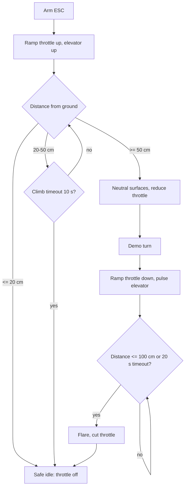

<div align="center">

# RC Plane Autopilot

**Automatic takeoff, demo turn and landing for an RC plane, using an Arduino and an ultrasonic ground sensor.**


[Features](#features) · [Hardware](#hardware) · [Getting Started](#getting-started)

</div>

---

## Overview

This project is a system that lets an RC plane take off and land on its own. An Arduino drives the ESC (throttle), the aileron servo and the elevator servo through a pre-programmed flight sequence, and uses an HC-SR04-style ultrasonic sensor to measure the height above the ground during takeoff and landing. It is an experimental prototype: the sequence is time-based and does not take input from an RC transmitter.

## Features

- ESC arming routine at startup (900 µs throttle signal for 4 seconds)
- Gradual throttle ramp-up for takeoff (1000 → 1500 µs in 10 µs steps)
- Ultrasonic altitude check after takeoff:
  - **Aborts** (throttle off, safe idle) if the plane is still within 20 cm of the ground
  - **Aborts** if it has not climbed to 50 cm within 10 seconds
  - Continues the sequence once it is 50 cm or more above the ground
- Throttle reduction to a cruise/idle setting after takeoff
- Demonstration turn using aileron and elevator
- Gradual throttle ramp-down and elevator flare for landing
- Throttle cut and flare when the plane is within 100 cm of the ground (or after a 20 s landing timeout)
- Ends in a **safe idle state**: motor off, control surfaces neutral
- Correct 10 µs ultrasonic trigger pulse and a 30 ms `pulseIn()` timeout, so a missing echo can never freeze the program
- Serial debug output (9600 baud) of throttle values, measured distance and abort reasons

## Hardware

| Component | Purpose |
|---|---|
| Arduino board (e.g. Uno / Nano) | Runs the flight sequence |
| ESC + brushless motor | Propulsion, controlled as a servo signal |
| Servo (aileron) | Roll control |
| Servo (elevator) | Pitch control |
| Ultrasonic distance sensor (HC-SR04 or similar) | Measures height above the ground |
| Flight battery / BEC | Powers the ESC, servos and Arduino |

## Pin Connections

| Arduino Pin | Constant | Connected To |
|---|---|---|
| D10 | `THROTTLE_PIN` | ESC signal (throttle) |
| D9 | `AILERON_PIN` | Aileron servo signal |
| D11 | `ELEVATOR_PIN` | Elevator servo signal |
| D8 | `TRIG_PIN` | Ultrasonic sensor TRIG |
| D7 | `ECHO_PIN` | Ultrasonic sensor ECHO |
| GND | – | Common ground for all devices |

## How It Works

1. **Arm** – the ESC receives a minimum-throttle signal (900 µs) for 4 seconds.
2. **Takeoff** – throttle ramps up to 1500 µs and the elevator is set slightly up.
3. **Climb check** – the ultrasonic sensor is polled:
   - ≤ 20 cm → takeoff failed → throttle off, safe idle
   - no climb to 50 cm within 10 s → takeoff failed → throttle off, safe idle
   - ≥ 50 cm → continue
4. **Cruise** – control surfaces return to neutral and throttle is stepped down to 1300 µs.
5. **Manoeuvre** – aileron and elevator are deflected for 5 seconds as a demonstration turn, then neutralised.
6. **Landing** – throttle ramps down to 1000 µs and the elevator is pulsed up. When the plane is within 100 cm of the ground (or after 20 s) the elevator flares and the throttle is cut.
7. **Safe idle** – throttle held at minimum, surfaces neutral, program stops.

If no echo returns (the sensor is out of range, about 5 m), the distance is reported as `500` cm.



## Getting Started

1. Install the [Arduino IDE](https://www.arduino.cc/en/software).
2. Open `autonomus_rc_plane/autonomus_rc_plane.ino`.
3. Select your board under **Tools → Board** (e.g. *Arduino Uno* or *Arduino Nano*) and the correct **Port**.
4. Libraries: only `Servo` is used, which is bundled with the Arduino IDE.
5. Click **Upload**, then open the Serial Monitor at **9600 baud** to watch throttle and distance values.
6. Adjust the altitude limits and timeouts at the top of the sketch (`TAKEOFF_FAIL_CM`, `TAKEOFF_OK_CM`, `LANDING_FLARE_CM`, `TAKEOFF_CLIMB_TIMEOUT_MS`, `LANDING_TIMEOUT_MS`) to suit your plane.

> **Safety:** remove the propeller when testing on the bench. The sequence starts automatically on power-up and there is no manual override from an RC transmitter.

## Project Structure

```
Autopilot_rcplane-/
├── autonomus_rc_plane/
│   └── autonomus_rc_plane.ino   # Flight sequence sketch
├── LICENSE
└── README.md
```

## Future Improvements

- Add RC receiver input so the pilot can take over at any time (failsafe / manual override)
- Use an IMU (gyro + accelerometer) for closed-loop attitude stabilisation instead of fixed servo positions
- Replace the fixed delays with a non-blocking state machine

## Author

**Swayam Khantwal** – [GitHub @Swayam7024](https://github.com/Swayam7024)

## License

This project is licensed under the MIT License – see the [LICENSE](LICENSE) file for details.
